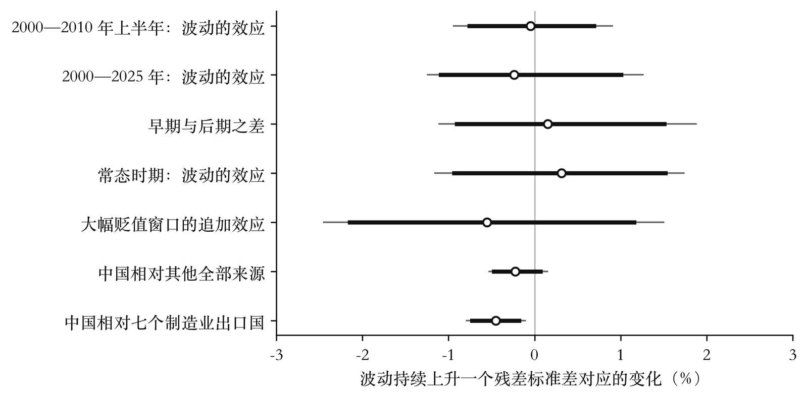

<a href="https://qiushi.luluh.top/"><picture>
  <source media="(prefers-color-scheme: dark)" srcset="assets/qiushi-dark.svg">
  
</picture></a>

**状态：** 刊于《求史》（Qiushi Papers，[qiushi.luluh.top](https://qiushi.luluh.top/)）的工作论文（2026 年 11 月稿），未经同行评审。2026-11-21 修订：写明效应换算用的是残差标准差，补充讨论一项显著的稳健性检验，说明“预先写定”的限度，删去对未成文在线附录的引用，交换图 2、图 3 编号，补齐部分文献题录；估计结果和表中数字没有变化。

# 伙伴货币汇率波动对中国出口的影响有多大？

[[论文 PDF]](paper/export-volatility-working-paper.pdf)
[[在线阅读]](https://qiushi.luluh.top/export-volatility-working-paper/)
[[English edition]](https://qiushi.luluh.top/en/export-volatility-working-paper/)
[[English PDF]](paper/export-volatility-working-paper-en.pdf)
[[正文表格]](results/tables.md)
[[引用]](#引用)

本仓库发布工作论文《伙伴货币汇率波动对中国出口的影响有多大？——基于 2000—2025 年分伙伴月度数据的再检验》。论文用 2000—2025 年中国对 96 个贸易伙伴的月度出口和 69 种货币的日度汇率，用泊松伪极大似然估计（PPML）和适用于少聚类的推断方法，重新检验伙伴货币的汇率波动是否抑制了中国出口。

## 主要结果



*图 2　主要估计值与置信集。圆点为点估计，粗线为 90% 置信集，细线为 95% 置信集（wild score bootstrap），均换算为波动持续上升一个残差标准差对应的变化（%）。*

- 伙伴货币波动对中国出口的影响在 2010 年以前和以后都不显著。置信集排除了波动持续上升一个残差标准差（扣除固定效应后）使出口变化超过约 1.3% 的情形。
- 同一设定下，人民币对伙伴货币贬值 1%，半年内对该伙伴的出口增加约 0.26%，是显著的。
- 没有发现效应集中在伙伴货币大幅贬值的时期。
- 在同一伙伴同一月份之内比较，伙伴自中国的进口与自其他来源的进口对其货币波动的反应没有显著差别，差别不超过约 0.5%（按进口方样本的残差标准差计算）。
- 用香港转口和中国复进口的分商品数据检验，没有发现套利性往返贸易随中美利差变化，2022 年利差由正转负以后也没有。

## 数据与方法

| 项目 | 说明 |
|---|---|
| 出口与伙伴进口 | IMF 国际商品贸易统计，月度，1999-01—2025-12 |
| 汇率 | BIS 日度汇率，人民币对伙伴货币由兑美元汇率套算 |
| 往返贸易 | 香港政府统计处转口与进口分商品数据、UN Comtrade 中国复进口数据 |
| 样本 | 96 个贸易伙伴、69 种货币，27167 个伙伴—月观测 |
| 估计 | PPML，伙伴 × 年份和年月固定效应 |
| 推断 | CR1、CV3 刀切、wild score bootstrap；有效聚类数和逐一去掉货币的结果一并报告 |

设定、样本规则和解读标准在看到结果之前写定；看到结果以后增加的分析在文中标“事后”。

## 仓库内容

| 位置 | 内容 |
|---|---|
| `paper/` | 论文 PDF（14 页） |
| `figures/` | 图 1—图 3 |
| `results/tables.md` | 表 1—表 7（描述统计、基准结果、效应的界、稳健性、大幅贬值窗口、中国相对其他供应方、往返贸易） |
| `CITATION.cff` | 引用信息（GitHub 右侧的 “Cite this repository” 由它生成） |

复现代码暂未公开。原始数据都来自上表列出的公开来源，部分来源的使用条款不允许转发，因此仓库不附原始数据。

## English abstract

**How Large Is the Effect of Partner-Currency Volatility on China's Exports? A Re-examination Using Monthly Partner-Level Data, 2000–2025**

China's exports increasingly go to emerging economies with volatile currencies. Whether partner-currency exchange rate risk depresses these exports is still unsettled: most of the existing studies we have found use samples that end before 2016, and few account for the fact that the independent variation comes from only a few dozen currencies. Using monthly exports from China to 96 trading partners and daily exchange rates of 69 currencies over 2000–2025, this paper re-examines the question with Poisson pseudo-maximum likelihood and inference methods suited to few clusters. First, the effect of partner-currency volatility on China's exports is insignificant both before and after 2010; the confidence sets rule out changes in exports larger than about 1.3% from a persistent rise in volatility of one residual standard deviation (net of fixed effects), or about 2.6% for a rise from the sample median to the 90th percentile, whereas in the same specification a 1% depreciation of the RMB against the partner currency significantly raises exports by about 0.26% within six months. Second, there is no evidence that the effect is concentrated in periods of large partner-currency depreciation. Third, within the same partner and month, partners' imports from China and from other sources do not respond differently to the volatility of their currency, and the difference is no larger than about 0.5% when scaled by the residual standard deviation in the importer sample. Fourth, product-level data on Hong Kong re-exports and China's re-imports show no arbitrage-driven round-tripping trade that moves with the China–US interest rate differential, including after the differential turned negative in 2022. A secondary analysis suggests that, relative to other manufacturing exporters, China's exports to emerging economies fall more when their currencies depreciate sharply, but this result does not survive multiple-testing correction. The results indicate that, at the bilateral aggregate level, everyday partner-currency volatility is not an important determinant of China's exports, and the exchange rate level deserves more attention.

**Keywords:** exchange rate volatility; exports; emerging economies; dominant currency pricing; inference with few clusters

## 中文摘要

中国出口越来越多地流向货币波动大的新兴经济体，伙伴货币的汇率风险是否抑制了出口，本文所见的已有研究样本大多止于 2016 年以前，统计推断也较少考虑独立变异只来自几十种货币这一限制。本文利用 2000—2025 年中国对 96 个贸易伙伴的月度出口和 69 种货币的日度汇率，用泊松伪极大似然估计和适用于少聚类的推断方法重新检验这一问题。研究发现：第一，伙伴货币波动对中国出口的影响在 2010 年以前和以后都不显著，置信集排除了波动持续上升一个残差标准差（扣除固定效应后）使出口变化超过约 1.3% 的情形，按波动从样本中位数升到 90 分位计算则为约 2.6%；同一设定下，人民币对伙伴货币贬值 1% 使出口在半年内增加约 0.26%，是显著的。第二，没有发现效应集中在伙伴货币大幅贬值的时期。第三，在同一伙伴同一月份之内比较，伙伴自中国的进口与自其他来源的进口对其货币波动的反应没有显著差别，按进口方样本的残差标准差计算，差别不超过约 0.5%。第四，用香港转口和中国复进口的分商品数据检验，没有发现套利性往返贸易随中美利差变化，2022 年利差由正转负以后也没有。次要分析提示，相对于其他制造业出口国，中国对新兴经济体的出口在其货币大幅贬值时下降更多，但这一结果没有通过多重检验校正。本文的结果说明，在双边总量层面，伙伴货币的日常汇率波动不是影响中国出口的重要因素，汇率水平的作用更值得关注。

**关键词：** 汇率波动；出口；新兴经济体；主导货币定价；少聚类推断

## 引用

```bibtex
@article{luluh2026export,
  author       = {撸撸黄},
  title        = {伙伴货币汇率波动对中国出口的影响有多大？——基于 2000—2025 年分伙伴月度数据的再检验},
  journal      = {求史},
  year         = {2026},
  month        = {11},
  note         = {工作论文，未经同行评审},
  url          = {https://qiushi.luluh.top/export-volatility-working-paper/}
}
```

GB/T 7714：撸撸黄. 伙伴货币汇率波动对中国出口的影响有多大？——基于 2000—2025 年分伙伴月度数据的再检验[J/OL]. 求史, 2026[引用日期]. https://qiushi.luluh.top/export-volatility-working-paper/.

## 许可

论文、图和表以 [CC BY 4.0](LICENSE) 许可发布：注明作者和出处，即可转载、改编。
